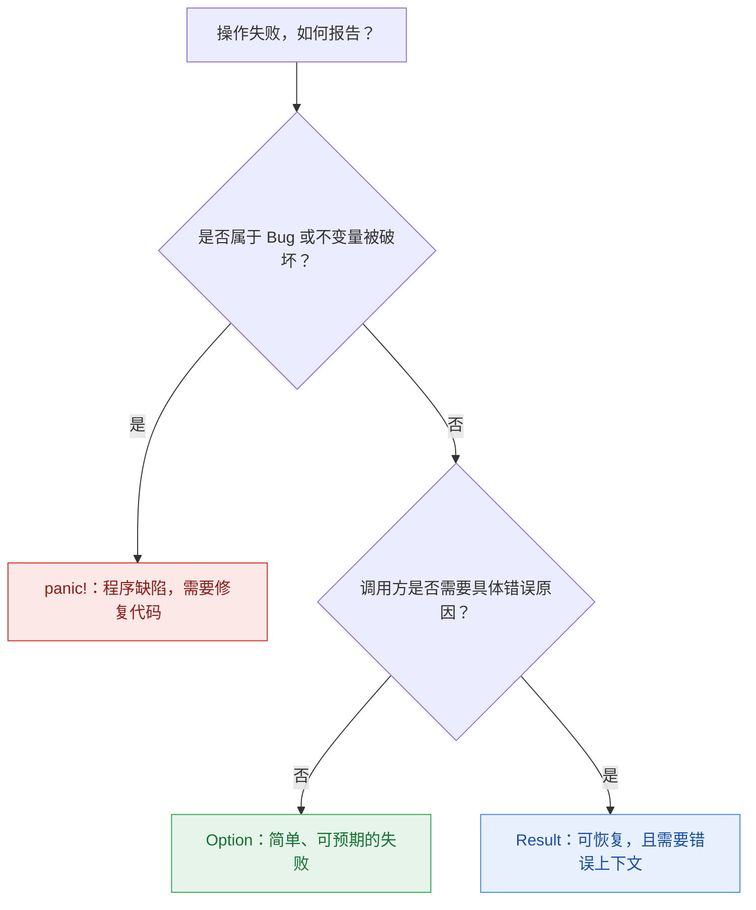

+++
title = 'Google Rust Style Guide 阅读笔记：我认为值得关注的规则'
date = 2026-11-08T00:00:00+08:00
lastmod = 2026-11-08T00:00:00+08:00
draft = false
image = 'cover.png'
description = '结合 Google Rust Style Guide，讨论函数签名、类型、Trait、错误处理与实现方式中的常见取舍。'
categories = ['rust']
tags = ['rust', 'coding-style', 'api-design']
+++

最近 Google 发布了一个文档：[Rust Style Guides](https://google.github.io/styleguide/rustguide.html)，介绍了 Rust 相关的编码规范，作为一个 Rust 语言的爱好者，这里我做了一个总结，挑选了几个觉得比较重要但又容易被忽视的编码规范。

阅读文章前的前提：你不是一个对 Rust 毫无了解的人，至少要知道 Rust 基础语法，因为下面规则中很多相关语法概念不会从头解释。

## 前置说明：不同场景遵循不同规则

文档在开头有前置描述：API 设计规范应该根据代码的使用场景来灵活应用，没有唯一标准。

所以 Google 推荐区分两种场景：

- Library Code：面向库，关注 API 设计和通用性，对于 API 设计规范要严格遵循。
- Application Code：面向应用，关注如何解决具体的问题，建议遵循 API 设计规范，但不强制，避免过度设计。

## 1. Function inputs and outputs

### 1.1. 对于不可变数据，采用灵活的引用

场景：当函数只需要不可变借用（Immutable Borrow）时，优先使用通用引用，而不是依赖具体的智能指针、容器或包装类型

核心思想：**优先借用数据本身，而非具体容器**，这样能让 API 更加通用

| ✅推荐写法   | ❌不推荐写法 | 原因                                    | 底层原因                                               |
| ------------ | ------------ | --------------------------------------- | ------------------------------------------------------ |
| `&T`         | `&Box<T>`    | 只需要访问 T，不需要关心是否由 Box 管理 | 不关心 T 是存在 stack 中还是 heap 中                   |
| `&[T]`       | `&Vec<T>`    | 接受任意连续元素 slice，而不局限于 Vec  | Slice：兼容 Vec、数组及其切片                          |
| `&str`       | `&String`    | 接受任意字符串 slice，不局限于 String   | 由于解引用，`&String` 会被自动转为 `&str`              |
| `Option<&T>` | `&Option<T>` | 表示可选的数据借用，而非借用整个 Option | `Option::as_ref()` 可将 `&Option<T>` 转为 `Option<&T>` |

为什么推荐这样写？主要两点原因：

1. 保证通用性，API 不依赖具体容器或包装类型，能让函数接收不同来源的数据
2. 性能，因为能够直接借用已有数据，就不需要为了适配参数而分配或复制数据

但这里有一个例外：非连续存储的文本数据（Non-linear Character Data），如 Rope / Cord，无法简单地用一个 `&str` 表示完整内容，需要使用对应的数据结构或抽象

原文：[Accept flexible references for immutable data](https://google.github.io/styleguide/rustguide.html#accept-flexible-references-for-immutable-data)

## 2. Types

### 2.1 Newtype 和 type aliase 的使用

Newtype 可以创建独立类型，增加类型安全和封装能力。

Google 推荐以下场景可以使用 newtype：

| 场景                                              | 解释                                                   | 示例                                 |
| ------------------------------------------------- | ------------------------------------------------------ | ------------------------------------ |
| 1. **语义差异明显（Semantic Differences）**       | 即使底层类型相同，业务含义不同，也应该通过独立类型区分 | UserId(u64)、OrderId(u64)            |
| 2. **需要独立 API（Own API）**                    | 新类型需要专属方法、校验逻辑或 Trait 实现              | Email(String) 提供 parse()、domain() |
| 3. **隐藏底层实现（Implementation Flexibility）** | 未来可能修改内部存储类型，同时尽量保持外部 API 稳定    | UserId(u64) 以后改成 UserId(Uuid)    |
| 4. **类型安全（Type Safety）**                    | 防止参数或计算过程混淆不同业务概念                     | Day(u8)、Month(u8)、Year(i32)        |

原文：[Newtypes versus type aliases](https://google.github.io/styleguide/rustguide.html#newtypes-versus-type-aliases)

### 2.2 优先使用具名字段，而非 Tuple

在设计数据结构时，推荐优先使用具名字段替代 Tuple，以提高代码可读性，也能够防止通过 `.0`, `.1` 等索引访问字段时产生歧义

这里有例外情况：使用 newtype，或局部场景简单使用时，可以就使用 Tuple

代码案例：

```rust
// ❌ 多字段 Tuple Struct，字段含义不直观
struct User(String, u32);

let user = User("Alice".into(), 20);
println!("{}", user.1);

// ✅ 具名字段，语义清晰
struct User {
    name: String,
    age: u32,
}

// ✅ Newtype：单字段 Tuple Struct
struct UserId(u64);

// ✅ 局部简单场景：Tuple
let (name, age) = ("Alice", 20);
```

原文：[Prefer named fields over tuples and non-newtype tuple structs](https://google.github.io/styleguide/rustguide.html#prefer-named-fields-over-tuples-and-non-newtype-tuple-structs)

## 3. Traits

### 3.1 优先实现标准库 Trait

当自定义方法的功能与 Rust 标准库 Trait 重合时，**优先实现标准库已有的 Trait**，而不是定义功能相同的自定义方法，提高 API 一致性与生态兼容性

例如，一个值需要被打印给开发者看，可以考虑实现 `Debug`；需要以面向用户的文本展示时，再考虑 `Display`。这样，调用者能直接使用 `{:?}`、`{}` 等惯用写法。对于能够正确派生的 Trait，可以先用 `#[derive(...)]`，无需手写重复实现。前提是该 Trait 的语义确实适合这个类型，不能只为凑齐常见 Trait 而盲目实现。

原文：[Implement known standard library traits instead of custom methods](https://google.github.io/styleguide/rustguide.html#implement-known-standard-library-traits-instead-of-custom-methods)

### 3.2 什么时候定义 Trait

如果方法只是某个类型自身的行为，直接写在 `impl Type` 中即可。只有当多个类型需要遵守同一契约，或调用方确实需要通过该契约接收不同实现时，才值得抽出 Trait。Trait 会成为调用方需要理解和维护的 API；单纯为了把方法分组，不必引入这个抽象。

原文：[When to define a trait versus an inherent implementation](https://google.github.io/styleguide/rustguide.html#when-to-define-a-trait-versus-an-inherent-implementation)

### 3.3 为配置结构体提供 Default

如果配置结构体有一组合理的默认值，实现 `Default` 可以让调用方只写需要调整的字段：

```rust
struct Options {
    retries: u32,
    verbose: bool,
}

impl Default for Options {
    fn default() -> Self {
        Self { retries: 3, verbose: false }
    }
}

let options = Options { verbose: true, ..Options::default() };
```

默认值应该是有意义且稳定的选择。如果某个字段必须由调用方明确提供，或随意给出默认值会掩盖配置错误，就不必强行实现 `Default`。

原文：[Options structs should implement Default](https://google.github.io/styleguide/rustguide.html#options-structs-should-implement-default)

## 4. Concurrency

### 4.1 持锁线程 panic 后，先检查数据是否仍然一致

假设 `Mutex` 保护一份数据：`items` 保存条目，`total` 保存条目之和。一次更新先向 `items` 添加条目，再更新 `total`。如果线程在两步之间 panic，锁会被释放，但 `total` 可能已经与 `items` 不一致。

这时，其他线程调用 `lock()` 会收到 `PoisonError`。它不表示锁再也不能使用，也不证明数据一定损坏；它是在提醒我们：上一个持锁线程异常退出，使用数据前应确认 `total` 是否仍等于 `items` 之和。

如果数据确实不一致，可以停止当前操作，也可以先修复数据再继续。`PoisonError` 中仍包含锁的 guard，允许程序检查或恢复数据。Google 的 Style Guide 要求其项目不要绕过 poison 状态直接访问内部数据；在一般 Rust 代码中，是否恢复仍须依据受保护数据的不变量判断，不能只为消除错误而忽略提示。

原文：[Handling poison](https://google.github.io/styleguide/rustguide.html#handling-poison)

## 5. Naming

### 5.1 用方法名表达所有权语义

对于转换方法：

- `as_` 通常提供借用视图
- `to_` 通常从借用创建新值
- `into_` 则消费 `self`

例如 `as_str()` 借用字符串内容，`into_bytes()` 消费原值并取得字节。调用者看见名称，就能预判自己之后还能否继续使用原值。

原文：[Naming methods](https://google.github.io/styleguide/rustguide.html#naming-methods)

### 5.2 用构造函数名表达失败可能性

- 直接构造可以用 `new()`
- 构造可能失败时可以用 `try_new()` 并返回 `Result`
- 从其他类型转换时，先考虑标准的 `From`／`TryFrom` 是否合适。名称应与实际行为一致，比如 `try_new()`, `from_xxx()` 之类的命名

原文：[Naming initialization functions](https://google.github.io/styleguide/rustguide.html#naming-initialization-functions)

### 5.3 避免难懂的缩写

不要为了缩短名称而使用只有项目内部成员才懂的缩写。广泛认可的缩写可以保留，比如 `IpAddr`, `HttpClient` 等；判断标准是调用者能否在阅读代码时理解其含义。

原文：[Avoid abbreviations](https://google.github.io/styleguide/rustguide.html#avoid-abbreviations)

## 6. Write Documentation

### 6.1 何时编写文档注释

对于公共 API，原则上应有文档注释，帮助调用者理解其用途和约束；

`missing_docs` lint 可以检查哪些公开项缺少文档。但注释不必机械覆盖每一个名称：如果只是重复函数名，或 enum 变体的含义已经十分直观，单独写一句同义解释并不能增加信息。

原文：[When and how to write documentation](https://google.github.io/styleguide/rustguide.html#when-and-how-to-write-documentation)（何时写）

### 6.2 文档注释要包含什么内容

文档应写调用者需要知道、但签名无法完整表达的信息，例如参数约束、返回值含义和副作用。关键功能可以给出使用示例；可能 panic 的函数应说明触发条件；`unsafe` 函数或 Trait 要明确安全前提和必须维持的不变量。不要重复代码本身或读者已经了解的 Rust 基础知识。

原文：[When and how to write documentation](https://google.github.io/styleguide/rustguide.html#when-and-how-to-write-documentation)（写什么）

### 6.3 文档注释使用什么格式

`///` 通常写在函数、结构体和 Trait 等 item 前；`//!` 通常用于模块或 crate 级文档。文档注释支持 Markdown，可以用标题、列表和代码示例组织内容。普通的 `//` 注释则用于说明实现细节或设计原因。

原文：[When and how to write documentation](https://google.github.io/styleguide/rustguide.html#when-and-how-to-write-documentation)（注释格式）

### 6.4 区分文档注释和普通注释

文档注释面向 API 使用者，会被 rustdoc 和 IDE 提取、展示；普通注释主要帮助阅读源码的人理解实现。两者可以同时存在，但分别回答“如何使用这个 API”和“这里为什么这样实现”。

原文：[When and how to write documentation](https://google.github.io/styleguide/rustguide.html#when-and-how-to-write-documentation)（与普通注释的区别）

## 7. Reporting errors

Rust 中常见的错误处理方式有三种：`Option`, `Result` 和 `panic!`，根据不同场景选择不同方式。

### 7.1 正常缺失且不需要原因时使用 Option

当调用者只需知道有没有值，`Option<T>` 就足够了。例如查找不存在的元素，或 `checked_add` 检测到溢出。不要为了表达简单缺失而制造没有实质信息的错误类型。

原文：[Reporting errors](https://google.github.io/styleguide/rustguide.html#reporting-errors)（Option）

### 7.2 调用方需要错误原因时使用 Result

如果调用者需要区分失败原因，或据此采取不同处理方式，就使用 `Result<T, E>`。例如打开文件可能因文件不存在或权限不足而失败，这些信息会影响后续处理。

原文：[Reporting errors](https://google.github.io/styleguide/rustguide.html#reporting-errors)（Result）

### 7.3 违反不变量时考虑 panic

`panic!` 适合表示程序不变量或 API 前置条件被破坏，例如要求索引有效的操作却收到了越界索引。它不应代替本来可以由调用者处理的运行时错误。

原文：[Reporting errors](https://google.github.io/styleguide/rustguide.html#reporting-errors)（panic）

### 7.4 决策链

这里是我自己总结的一个错误处理方式选择决策链，你可以参考：



## 8. Ownership & Borrowing

### 8.1 避免过早使用 Rc 或 Arc

`Rc` 和 `Arc` 分别用于相应的单线程和跨线程共享所有权场景。很多 Rust 初学者在了解到 `Rc` 和 `Arc` 后，就为了方便频繁使用这两个智能指针，这本身也没有什么错，只是需要考虑使用场景。

因为它们会增加引用计数和对象关系的复杂度，所以推荐只要在确实需要共享所有权时，才使用这两个智能指针，不然优先使用独占所有权和借用，不提前引入额外复杂度。

原文：[Avoid Rc and Arc](https://google.github.io/styleguide/rustguide.html#avoid-rc-and-arc)

### 8.2 优先借用，而不是为了方便深拷贝

另一个 Rust 新手容易犯的错误：随意使用 `.clone()` 方法。这里不是说因为有内存开销所以不使用 `.clone()` ，我觉得对于新手来说不必考虑太多复杂情况，先使用 `.clone()` ，后续优化代码和架构时再考虑换为更节省内存的方式。

但是这里也是想让大家养成一个好习惯，尽量不要随便使用 `.clone()` 方法，而是优先通过 Borrowing 复用已有数据

例外情况：以下情况可放心使用 `.clone()`

- 确实需要数据副本，比如需要长期保存的数据
- 借用关系过于复杂，导致代码难以理解和维护时，可以用 `.clone()` 来换取代码易读性

原文：[Prefer borrows over deep copies](https://google.github.io/styleguide/rustguide.html#prefer-borrows-over-deep-copies)

## 9. Other Rust Features

### 9.1 可扩展的公共 enum 考虑 non_exhaustive

对外公开的 enum 如果预计将来增加变体，可以考虑 `#[non_exhaustive]`。它强制外部调用者在匹配时要保留兜底分支，为以后扩展 API 留空间，保证了兼容性和可扩展性。

但也有一些例外：

- 固定枚举：比如只有几种固定状态的枚举
- 可统一修改的 API，比如通过 Large-Scale Change 统一修复新增变体导致的编译错误

原文：[Apply #\[non_exhaustive\] to publicly-exposed enums](https://google.github.io/styleguide/rustguide.html#apply-non_exhaustive-to-publicly-exposed-enums)

### 9.2 按访问和修改方式设计 Getter 与 Setter

Rust 的所有权和借用会影响访问器的形式。Getter 和 Setter 的名称应让调用者看出它是借用、修改字段，还是取走旧值。可以参考以下惯例：

| 方法                 | 表达的操作                                              |
| -------------------- | ------------------------------------------------------- |
| `foo()`              | 只读访问，通常返回 `&T`；小型 `Copy` 值也可直接返回 `T` |
| `foo_mut()`          | 返回 `&mut T`，允许调用者直接修改字段                   |
| `set_foo(value)`     | 设置新值，通常不返回旧值                                |
| `take_foo()`         | 从 `&mut self` 取出旧值，并将字段留在空值或默认状态     |
| `replace_foo(value)` | 替换字段并返回旧值                                      |

如果修改字段后必须校验、通知，或字段由 `Mutex`、`RefCell` 管理，就不宜直接暴露可变引用。此时可以提供受控方法，必要时用 `with_foo()`、`with_mut_foo()` 这样的闭包访问器限定访问作用域。闭包访问器只在确实需要控制作用域时使用，普通字段访问无需增加这层包装。

原文：[Getters and setters](https://google.github.io/styleguide/rustguide.html#getters-and-setters)

### 9.3 函数的返回值不可忽略时使用 must_use

`#[must_use]` 是 Rust 的内置 Attribute，用于提醒调用者：这个函数的返回值很重要，不应该被忽略。默认情况只是编译警告

如果某个函数的返回值对正确使用该函数至关重要，就可以在函数上标注 `#[must_use]` 提醒调用者。

使用场景通常有：纯函数、错误或关键状态

代码案例：

```rust
// ✅ 纯函数：返回值不应被忽略
#[must_use]
fn double(x: i32) -> i32 {
    x * 2
}

double(10); // ⚠️ Warning：返回值未被使用

// ✅ Result 已经具有 #[must_use]
fn save() -> Result<(), std::io::Error> {
    Ok(())
}

save(); // ⚠️ Warning：未处理 Result
```

原文：[#\[must_use\] on functions](https://google.github.io/styleguide/rustguide.html#must_use-on-functions)

### 9.4 类型的值不可忽略时使用 must_use

如果一个类型的值无论由哪个函数产生都不应被忽略，可以在类型上标注 `#[must_use]`，而不必为每个返回该类型的函数重复标注。

代码案例：

```rust
// ✅ 在类型上添加 #[must_use]
#[must_use = "The operation result must be handled"]
enum OperationResult {
    Success,
    Failure,
}

fn execute() -> OperationResult {
    OperationResult::Success
}

execute(); // ⚠️ Warning：忽略了 OperationResult
```

原文：[#\[must_use\] on types](https://google.github.io/styleguide/rustguide.html#must_use-on-types)

## 10. Implementation concerns

### 10.1 用模式匹配代替 check-then-unwrap

当 `Option` 或 `Result` 中的值需要先判断有效性，再提取内部数据时，Rust 新手很容易将其写为 check-then-unwrap，比如下面这样：

```rust
fn print_if_some(option: Option<i32>) {
    if option.is_some() {
        println!("{}", option.unwrap());
    }
}
```

这段代码可以工作，但读者必须同时追踪 `is_some()` 的检查和后面的 `unwrap()`，才能确认不会 panic。它们之间的关系没有在取值处直接表达出来；这不是说上面的代码在检查后会自行改变状态。

更好的做法是：直接改为模式匹配（`if let`、`match` 或 `let else`）。模式匹配**把检查和解构合并**，也让失败分支更清楚。比如下面这样：

```rust
fn print_if_some(option: Option<i32>) {
    if let Some(value) = option {
        println!("{value}");
    }
}
```

原文：[Prefer pattern matching over check-then-unwrap](https://google.github.io/styleguide/rustguide.html#prefer-pattern-matching-over-check-then-unwrap)

### 10.2 函数返回值选择集合还是迭代器

设计函数返回值时，先看结果是适合按需产生，还是已经构造好的集合。例如从现有切片筛出偶数，可以返回迭代器，把遍历或收集的选择交给调用方：

```rust
fn even_values(values: &[i32]) -> impl Iterator<Item = i32> + '_ {
    values.iter().copied().filter(|n| n % 2 == 0)
}

let values = [1, 2, 3, 4];
let first = even_values(&values).next();
let all: Vec<_> = even_values(&values).collect();
```

这里无需先为结果分配 `Vec`。但如果函数内部本来就构造了 `Vec`，或调用方普遍需要持有、重复遍历和索引结果，直接返回 `Vec<T>` 更合适。Google 的指南倾向于让可复用的库 API 在可行时返回迭代器，同时明确列出了这些返回集合的例外；应用内部代码可以按实际调用方式选择更直接的形式。

原文：[Iterators vs. owned collections in return types](https://google.github.io/styleguide/rustguide.html#iterators-vs-owned-collections-in-return-types)

### 10.3 函数参数选择 Iterator 还是 slice

设计函数参数时，先看函数是否只需要依次消费元素。如果是，`impl IntoIterator` 能直接接收数组、集合或迭代器链：

```rust
fn sum(values: impl IntoIterator<Item = i32>) -> i32 {
    values.into_iter().sum()
}

let from_array = sum([1, 2, 3]);
let from_range = sum(1..=3);
```

如果调用方总是持有连续数据，而函数需要切片语义，`&[T]` 则更简单：

```rust
fn first_two(values: &[i32]) -> Option<(&i32, &i32)> {
    Some((values.get(0)?, values.get(1)?))
}
```

Google 的指南建议高度可复用、且只需遍历输入的库 API 接受迭代器；应用内部代码若没有明显的灵活性或性能收益，接受 slice 也合适。这里不能只按“库”或“应用”二分，还要看实际操作是否需要连续存储、索引或多次访问。

原文：[Iterators vs. slices in function parameters](https://google.github.io/styleguide/rustguide.html#iterators-vs-slices-in-function-parameters)

### 10.4 函数参数优先使用 enum 而非 bool

当调用处的 `bool` 无法说明含义，例如 `process(data, true)`，可以改用 `enum` 表达模式。若布尔值的含义在调用处已经清楚，增加一个枚举反而会使接口更繁琐；重点是让调用方看懂这个参数代表什么。

原文：[Prefer enum over bool in APIs](https://google.github.io/styleguide/rustguide.html#prefer-enum-over-bool-in-apis)

### 10.5 不要过度依赖类型推断

用 Go 的同学对“类型推断”应该不陌生，Rust 也支持这个功能，能自动推断变量类型。

当结果类型无法从局部代码直接看出时，显式标注能提高可读性；类型已经很明显时，不必重复写出。

推荐显式标准类型的场景有：

- 泛型返回值方法，如 `.into()`, `.parse()` 等返回类型依赖上下文，难以直接判断
- 复杂 Iterator 链，如 多次 `map()`, `filter()`, `collect()` 后，结果类型可能不直观

类型可以写在变量声明处，也可以写在泛型方法调用处；以下两种 `parse` 写法都明确表达了 `u16`，不应把其中一种标成错误：

```rust
// 类型写在方法调用处
let port = "8080".parse::<u16>().unwrap();

// 类型写在变量声明处
let port: u16 = "8080".parse().unwrap();

// ✅ 复杂 Iterator 链，明确最终结果类型
let numbers: Vec<i32> = (1..100)
    .filter(|n| n % 2 == 0)
    .map(|n| n * 2)
    .collect();

// ✅ 类型明显，无需显式标注
let count = 10;
let name = String::from("Alice");
```

原文：[Don’t overuse type inference](https://google.github.io/styleguide/rustguide.html#dont-overuse-type-inference)

### 10.6 合理 panic 时用 expect 说明不变量

若某个不变量确实允许程序在违反时 panic，`expect("说明为什么这里必然有值")` 通常比没有上下文的 `unwrap()` 更利于排查。重点是解释不变量，而不是用 `expect()` 包装本应返回给调用者的错误。

原文：[Prefer expect over unwrap](https://google.github.io/styleguide/rustguide.html#prefer-expect-over-unwrap)

### 10.7 迭代器链难读时使用 for

Rust 的 `Iterator` 适合串起过滤、映射等数据处理。遇到复杂分支或需要修改外部状态时，`for` 循环通常更直接。

比如看下面的代码案例：需要遍历订单，筛选已支付且金额大于 100 的订单，计算折扣并输出结果

❌ 避免：复杂的 Iterator Combinator Chain

```rust
// 将过滤、折扣计算和打印副作用混合在一条 Iterator 链中，增加了理解成本
orders
    .iter()
    .filter(|order| order.paid) // 1. 筛选已支付的订单
    .filter(|order| order.amount > 100) // 2. 筛选金额大于 100 的订单
    .map(|order| {
        // 3. 计算折扣：金额大于 500 打 8 折，否则打 9 折
        let discount = if order.amount > 500 {
            0.2
        } else {
            0.1
        };

        // 4. 将订单映射为 (订单 ID, 折后金额)
        (order.id, order.amount * (1.0 - discount))
    })
    .for_each(|(id, final_amount)| {
        // 5. 遍历计算结果并打印，产生副作用
        println!("Order {id}: {final_amount}");
    });
```

✅ 推荐：使用 for 明确表达控制流程

```rust
// 使用 continue 明确跳过不符合条件的订单，折扣计算和输出操作也更加直观
for order in &orders {
    // 1. 跳过未支付或金额不大于 100 的订单
    if !order.paid || order.amount <= 100 {
        continue;
    }

    // 2. 计算折扣：金额大于 500 打 8 折，否则打 9 折
    let discount = if order.amount > 500 {
        0.2
    } else {
        0.1
    };

    // 3. 计算订单折后金额
    let final_amount = order.amount * (1.0 - discount);

    // 4. 打印订单 ID 和折后金额
    println!("Order {}: {final_amount}", order.id);
}
```

原文：[Don’t use iterator combinator chains when direct iteration is clearer](https://google.github.io/styleguide/rustguide.html#dont-use-iterator-combinator-chains-when-direct-iteration-is-clearer)

## 最后说几句

关于 Google 的这个 Rust 规范，其实在开头就已经表明了：这些适用于 Google 内部超大型 Rust 项目，所以我们自己在开发时也没必要完全遵循所有规范，按需选择即可。

## References

- [Google Rust Style Guide](https://google.github.io/styleguide/rustguide.html)
- [The Rust Style Guide](https://doc.rust-lang.org/style-guide/)
- [Rust API Guidelines](https://rust-lang.github.io/api-guidelines/)
